 

---

  

## `~/currently`

| STATUS | CURRENT FOCUS                                                         |
| :----- | :-------------------------------------------------------------------- |
| `01`   | Strengthening Python and backend engineering fundamentals             |
| `02`   | Learning FastAPI, REST APIs, databases, and service design            |
| `03`   | Exploring LLM applications and practical AI integration               |
| `04`   | Improving debugging, testing, code quality, and development workflows |
| `05`   | Learning in public and exploring open-source contributions            |

---

  

## `~/principles`

* **Learn deeply.** Understand the concepts behind the code.
* **Build deliberately.** Focus on useful, maintainable software.
* **Stay curious.** Explore emerging technologies while strengthening fundamentals.
* **Think systematically.** Break complex problems into manageable steps.
* **Improve consistently.** Make progress through continuous learning and practice.

---

  

 

---

## `~/connect`

**Open to learning, collaboration, and building useful software.**

<a href="https://github.com/sree77rag">GitHub · @sree77rag</a>

  

Designed with a dark canvas, sharp red accents, and a builder's mindset.

